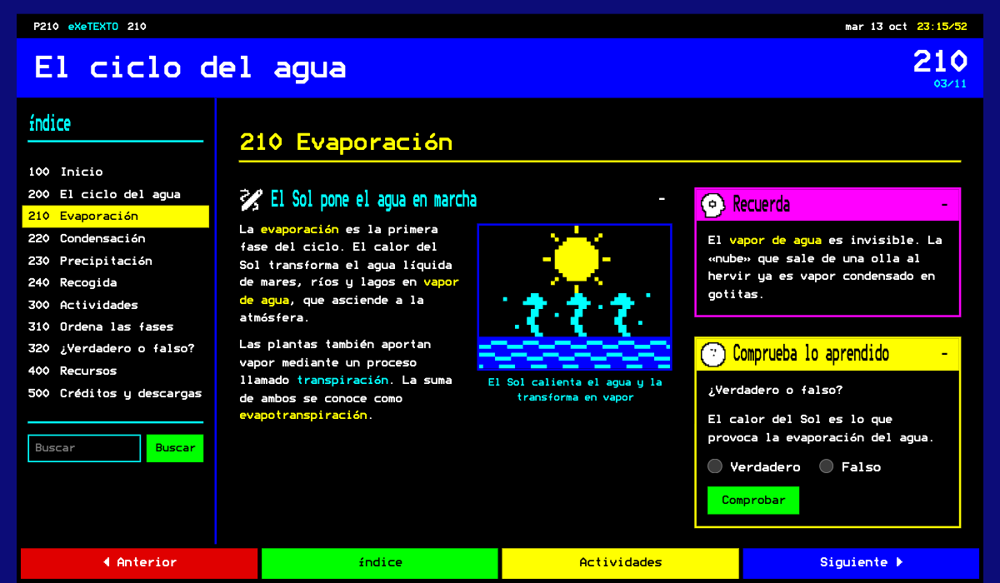

# eXeLearning eXeTexto

[![eXeLearning 4.0.5+](https://img.shields.io/badge/eXeLearning-4.0.5%2B-26ddc7?labelColor=1f2937&logo=data%3Aimage%2Fsvg%2Bxml%3Bbase64%2CPHN2ZyB4bWxucz0iaHR0cDovL3d3dy53My5vcmcvMjAwMC9zdmciIHZpZXdCb3g9IjAgLTAuNTE5IDYwLjE3MTUyIDYwLjE3MTUyIj4gPGcgdHJhbnNmb3JtPSJ0cmFuc2xhdGUoLTEwOS44MDIwOCwtMTIxLjE3OTE3KSI%2BIDxwYXRoIGQ9Im0gMTIwLjYzOTEyLDEyMS4xNzkxNiBjIDIuNTAyOTYsMCA1LjE3Njg0LDAuOTEwMiA4LjAyMTExLDIuNzMwNiAyLjc4NzY1LDEuNzYzNSA2LjYyNzU1LDQuODkyMzMgMTEuNTE5Nyw5LjM4NjQ0IDguNDE5MywtNy4wNTQwNiAxMi45MTAzNCwtOC42NDMwMSAxNy4yMzM2MywtOC42NDMwMSAyLjc4NzY1LDAgNS4xNzY4NCwwLjc2Nzk4IDcuMTY3ODMsMi4zMDM5NCAzLjY2NzkyLDIuODA0NzcgNC4yNzk2Myw5LjIxMDIyIDEuNzEsMTMuNDIxNTcgLTIuMDQ3ODcsMy4zNTYzNyAtNC43MjE3NSw2Ljk2ODczIC04LjAyMTExLDEwLjgzNzAxIDcuNTA5MTQsOC41MzMwOCAxMS43MDMzMiwxNC42NzMgMTEuNzAzMzIsMTguODgyNzkgMCwzLjAxNDkyIC0wLjkzODc0LDUuMzE4OTIgLTIuODE1OTYsNi45MTE3MSAtMS45MzQxMSwxLjU5Mjc5IC00LjM1MTg3LDIuMzg5MTkgLTcuMjUzMDMsMi4zODkxOSAtNC4zODA0NCwwIC0xMS4yNDg0OSwtMy4zMjM3IC0xOS43MjQ2OCwtMTAuNDM0NjQgLTQuODM1MjYsNC4yNjY0IC04LjY0Njg1LDcuMjI0NzEgLTExLjQzNDI0LDguODc0MzkgLTIuODQ0NTMsMS42NDk2NyAtNS41NDY3MiwyLjQ3NDY1IC04LjEwNjU3LDIuNDc0NjUgLTMuNDEzMjMsMCAtNi4wNTg1LC0xLjEwOTQgLTcuOTM1NzgsLTMuMzI3OTMgLTEuOTM0MTgsLTIuMjc1NjggLTIuOTAxMjYsLTQuOTQ5MyAtMi45MDEyNiwtOC4wMjExMSAwLC0xLjk5MTI2IDAuMjg0NDMsLTMuNzI2MTMgMC44NTMzMSwtNS4yMDU0MSAwLjU2ODg4LC0xLjQ3OTAzIDEuNjIxMjksLTMuMTI4NyAzLjE1NzI1LC00Ljk0OTA0IDEuNTM1OTYsLTEuODc3NDggMy45ODIxMywtNC40NjU2MyA3LjMzODQ1LC03Ljc2NTI1IC0zLjI0MjU0LC0zLjI5OTM2IC01LjYzMTgxLC01Ljk0NDcxIC03LjE2NzgsLTcuOTM1NzYgLTEuNTkyODQsLTIuMDQ3OTUgLTIuNjczNjksLTMuODM5OTIgLTMuMjQyNTcsLTUuMzc1ODggLTAuNjI1NzcsLTEuNTM1OTYgLTAuOTM4NjQsLTMuMjQyNTcgLTAuOTM4NjQsLTUuMTE5ODcgMCwtMS45OTEwNyAwLjQyNjY0LC0zLjgzOTkgMS4yNzk5NSwtNS41NDY1MSAwLjg1MzM0LC0xLjc2MzUzIDIuMTA0ODQsLTMuMTg1NzIgMy43NTQ2LC00LjI2NjU4IDEuNjQ5NzMsLTEuMDgwODcgMy41ODM5MSwtMS42MjEzIDUuODAyNDksLTEuNjIxMyB6IiBmaWxsPSIjMjZkZGM3Ii8%2BIDwvZz4gPC9zdmc%2B)](https://exelearning.net)
[](https://github.com/ateeducacion/exelearning-style-teletext/raw/refs/heads/main/content/resources/teletext.zip)
[![Edit in eXeLearning](https://img.shields.io/badge/Edit%20in-eXeLearning-26ddc7?labelColor=1f2937&logo=data%3Aimage%2Fsvg%2Bxml%3Bbase64%2CPHN2ZyB4bWxucz0iaHR0cDovL3d3dy53My5vcmcvMjAwMC9zdmciIHZpZXdCb3g9IjAgLTAuNTE5IDYwLjE3MTUyIDYwLjE3MTUyIj4gPGcgdHJhbnNmb3JtPSJ0cmFuc2xhdGUoLTEwOS44MDIwOCwtMTIxLjE3OTE3KSI%2BIDxwYXRoIGQ9Im0gMTIwLjYzOTEyLDEyMS4xNzkxNiBjIDIuNTAyOTYsMCA1LjE3Njg0LDAuOTEwMiA4LjAyMTExLDIuNzMwNiAyLjc4NzY1LDEuNzYzNSA2LjYyNzU1LDQuODkyMzMgMTEuNTE5Nyw5LjM4NjQ0IDguNDE5MywtNy4wNTQwNiAxMi45MTAzNCwtOC42NDMwMSAxNy4yMzM2MywtOC42NDMwMSAyLjc4NzY1LDAgNS4xNzY4NCwwLjc2Nzk4IDcuMTY3ODMsMi4zMDM5NCAzLjY2NzkyLDIuODA0NzcgNC4yNzk2Myw5LjIxMDIyIDEuNzEsMTMuNDIxNTcgLTIuMDQ3ODcsMy4zNTYzNyAtNC43MjE3NSw2Ljk2ODczIC04LjAyMTExLDEwLjgzNzAxIDcuNTA5MTQsOC41MzMwOCAxMS43MDMzMiwxNC42NzMgMTEuNzAzMzIsMTguODgyNzkgMCwzLjAxNDkyIC0wLjkzODc0LDUuMzE4OTIgLTIuODE1OTYsNi45MTE3MSAtMS45MzQxMSwxLjU5Mjc5IC00LjM1MTg3LDIuMzg5MTkgLTcuMjUzMDMsMi4zODkxOSAtNC4zODA0NCwwIC0xMS4yNDg0OSwtMy4zMjM3IC0xOS43MjQ2OCwtMTAuNDM0NjQgLTQuODM1MjYsNC4yNjY0IC04LjY0Njg1LDcuMjI0NzEgLTExLjQzNDI0LDguODc0MzkgLTIuODQ0NTMsMS42NDk2NyAtNS41NDY3MiwyLjQ3NDY1IC04LjEwNjU3LDIuNDc0NjUgLTMuNDEzMjMsMCAtNi4wNTg1LC0xLjEwOTQgLTcuOTM1NzgsLTMuMzI3OTMgLTEuOTM0MTgsLTIuMjc1NjggLTIuOTAxMjYsLTQuOTQ5MyAtMi45MDEyNiwtOC4wMjExMSAwLC0xLjk5MTI2IDAuMjg0NDMsLTMuNzI2MTMgMC44NTMzMSwtNS4yMDU0MSAwLjU2ODg4LC0xLjQ3OTAzIDEuNjIxMjksLTMuMTI4NyAzLjE1NzI1LC00Ljk0OTA0IDEuNTM1OTYsLTEuODc3NDggMy45ODIxMywtNC40NjU2MyA3LjMzODQ1LC03Ljc2NTI1IC0zLjI0MjU0LC0zLjI5OTM2IC01LjYzMTgxLC01Ljk0NDcxIC03LjE2NzgsLTcuOTM1NzYgLTEuNTkyODQsLTIuMDQ3OTUgLTIuNjczNjksLTMuODM5OTIgLTMuMjQyNTcsLTUuMzc1ODggLTAuNjI1NzcsLTEuNTM1OTYgLTAuOTM4NjQsLTMuMjQyNTcgLTAuOTM4NjQsLTUuMTE5ODcgMCwtMS45OTEwNyAwLjQyNjY0LC0zLjgzOTkgMS4yNzk5NSwtNS41NDY1MSAwLjg1MzM0LC0xLjc2MzUzIDIuMTA0ODQsLTMuMTg1NzIgMy43NTQ2LC00LjI2NjU4IDEuNjQ5NzMsLTEuMDgwODcgMy41ODM5MSwtMS42MjEzIDUuODAyNDksLTEuNjIxMyB6IiBmaWxsPSIjMjZkZGM3Ii8%2BIDwvZz4gPC9zdmc%2B)](https://static.exelearning.dev/?url=https://github-proxy.exelearning.dev/?repo=ateeducacion/exelearning-style-teletext&branch=main)

Estilo de eXeLearning que presenta el recurso como un **servicio de teletexto**: pantalla
negra, los ocho colores del teletexto, la tipografía Bedstead del generador de caracteres
SAA5050 y titulares a doble altura. Cada página tiene su número (100, 200, 210…), que se
puede teclear como con el mando de la tele, y las cuatro teclas de colores llevan a la
página anterior, al índice, a las actividades y a la siguiente. El ejemplo incluye las 11
páginas de **El ciclo del agua**, con un recordatorio y una pregunta rápida en cada fase y
las actividades de ordenar las fases y verdadero/falso.



[Descargar estilo eXeTexto](https://github.com/ateeducacion/exelearning-style-teletext/raw/refs/heads/main/content/resources/teletext.zip) · [Abrir el ejemplo en eXeLearning](https://static.exelearning.dev/?url=https://github-proxy.exelearning.dev/?repo=ateeducacion/exelearning-style-teletext&branch=main)

Importa `teletext.zip` desde el gestor de estilos de eXeLearning 4.0.5 o posterior.
La raíz del repositorio es el ejemplo ELPX descomprimido; `theme/` contiene el estilo.
El botón «Edit with eXeLearning» es solo del ejemplo: está en `edit-in-exelearning.js`,
fuera del estilo, y no aparece en los recursos que se exporten con él.

## Leer el teletexto

- **Números de página**: las páginas de primer nivel son la 100, 200, 300…; sus
  subpáginas, 210, 220…; y las del tercer nivel, 211, 212… Si el árbol no cabe (más de 8
  páginas de primer nivel, más de 9 subpáginas o más de tres niveles), se numeran 100,
  101, 102… en orden de lectura. El número aparece en el índice, en el título de la página
  y en la cabecera.
- **Teclear una página**: escribe sus tres cifras fuera de los campos y de las actividades.
  La fila de cabecera muestra lo tecleado (`P21-`) y salta a la página al completar el
  número; si no existe, el número se pone en rojo. Retroceso borra una cifra.
- **Fila de cabecera**: página, nombre del servicio, fecha y reloj, como en el teletexto.
- **Teclas de colores** al pie, siempre visibles:
  - **roja**: página anterior (también con ←);
  - **verde**: el índice. En pantallas anchas lleva el foco al índice lateral; en el móvil
    lo abre sobre la página (Escape lo cierra);
  - **amarilla**: las actividades. Va a la página que se llame «Actividades» (o
    *Activitats*, *Jarduerak*, *Activities*…); desde ella, o si no existe, a la siguiente
    página con una actividad. Si no hay ninguna, la tecla se apaga;
  - **azul**: página siguiente (también con →).
- **Índice numerado** a la izquierda, con el buscador del recurso.

## Paneles de colores

Las cajas de texto llevan el título en cian a doble altura. Las actividades se enmarcan
en un panel amarillo, y cualquier caja puede elegir su color escribiendo una de estas
clases en el campo *Clase CSS* de sus propiedades:

| Clase | Panel |
|---|---|
| `tt-red` | rojo, título en blanco |
| `tt-green` | verde |
| `tt-yellow` | amarillo |
| `tt-blue` | azul, título en blanco |
| `tt-magenta` | magenta |
| `tt-cyan` | cian |
| `tt-white` | blanco |
| `tt-side` | lleva la caja a la columna lateral en pantallas anchas |

`tt-side` se combina con un color: en el ejemplo, «Recuerda» es `tt-magenta tt-side` y
la pregunta rápida, `tt-side`. En el móvil, las cajas laterales van detrás del contenido.

Sin JavaScript, o al imprimir, el contenido se lee como una página normal (al imprimir,
en tinta oscura sobre papel blanco).

## Tipografía e ilustraciones

[Bedstead](https://fontlibrary.org/es/font/bedstead), de Ben Harris, reproduce los
caracteres del SAA5050. La versión ancha normal se usa para el texto; la ultracondensada,
que mide la mitad, se usa al doble de tamaño para los titulares a doble altura. Ambas
están reducidas a WOFF2 con los caracteres latinos, los signos y los mosaicos del
teletexto (unos 15 KB cada una).

Bedstead dibuja las mayúsculas acentuadas como las minúsculas, porque la celda del
teletexto no tiene sitio para el acento, así que el estilo no pasa los títulos a
mayúsculas: conviene escribirlos en minúscula, como en el ejemplo.

Los iconos de los iDevices son los Material Symbols del estilo Zen de eXeLearning,
pixelados en una rejilla de 16 × 16 en blanco con contorno negro, para que se lean sobre
el negro, sobre los paneles de colores y en el selector de iconos del editor. Las 11
ilustraciones del ejemplo están dibujadas píxel a píxel en los ocho colores por
`scripts/pixel_art.py`.

## Vista previa y paquetes

```sh
python3 -m http.server 1314 --bind 127.0.0.1
python3 scripts/package.py
python3 scripts/check.py
```

Abre <http://localhost:1314/>. Los paquetes quedan en `dist/teletext.zip` y
`dist/ciclo-del-agua.elpx`; el ZIP del estilo también se copia a `content/resources/`
para descargarlo desde el ejemplo.

Las comprobaciones de navegador usan Chrome y el Playwright que ya incluye eXeLearning:

```sh
NODE_PATH=/ruta/a/exelearning/node_modules node scripts/check-browser.cjs
```

Recorren las 11 páginas con la tecla azul y vuelven con la roja, prueban las flechas, el
tecleo de números de página (también uno que no existe), las teclas verde y amarilla, la
columna lateral, las tres actividades y el índice del móvil a 390 y 320 px. Para
regenerar las miniaturas, añade
`TELETEXT_SCREENSHOT=theme/screenshot.png,screenshot.png,.github/screenshot.png` al comando.

## Mantenimiento y publicación

La estructura de publicación procede de los demás estilos de la colección: Actions,
`.gitignore`, `.gitattributes`, licencia y notas de `git archive`.

- `python3 scripts/build_water_cycle.py`: reconstruye el ejemplo ELPX y el estilo
  desde los archivos actuales.
- `python3 scripts/pixel_art.py`: vuelve a dibujar las ilustraciones del ejemplo.
- `NODE_PATH=/ruta/a/exelearning/node_modules node scripts/pixel_icons.cjs /ruta/a/exelearning/public/files/perm/themes/base/zen/icons`:
  regenera los iconos de `theme/icons/`.
- Para regenerar las páginas HTML del ejemplo, exporta el ELPX con el CLI de
  eXeLearning desde su propio directorio:
  `bun dist/cli.js elp:export /ruta/a/dist/ciclo-del-agua.elpx /tmp/teletext elpx`,
  descomprime `/tmp/teletext.elpx` y copia `index.html`, `html/`, `search_index.js`,
  `libs/` e `idevices/` (no el `content.xml`, que añade la captura en base64).
  Después, `python3 scripts/package.py` vuelve a añadir el botón del ejemplo.

El workflow **Release** se ejecuta manualmente desde Actions o al subir una etiqueta
`v*`. Comprueba el ejemplo y genera `exelearning-style-teletext-<versión>.zip`,
`teletext.zip` y `ciclo-del-agua.elpx`. En una ejecución manual se guardan como
artefactos; con una etiqueta se adjuntan a la release.

## Colección de estilos

Estilos de eXeLearning del Área de Tecnología Educativa. Cada repositorio incluye el estilo y un recurso de ejemplo que se puede abrir directamente en eXeLearning.

<table>
  <tr>
    <td align="center" width="33%"><a href="https://github.com/ateeducacion/exelearning-style-book"><br><b>Libro</b></a><br><sub>Libro abierto con paso de página</sub></td>
    <td align="center" width="33%"><a href="https://github.com/ateeducacion/exelearning-style-pocket"><br><b>Pocket</b></a><br><sub>Consola portátil de pantalla verde</sub></td>
    <td align="center" width="33%"><a href="https://github.com/ateeducacion/exelearning-style-hacker"><br><b>Hacker</b></a><br><sub>Terminal con Matrix, Tron y PipBoy</sub></td>
  </tr>
  <tr>
    <td align="center" width="33%"><a href="https://github.com/ateeducacion/exelearning-style-spectrum128k"><br><b>Spectrum 128K</b></a><br><sub>ZX Spectrum con franjas y CRT</sub></td>
    <td align="center" width="33%"><a href="https://github.com/ateeducacion/exelearning-style-scumm"><br><b>SCUMM Adventure</b></a><br><sub>Aventura gráfica con verbos e inventario</sub></td>
    <td align="center" width="33%"><a href="https://github.com/ateeducacion/exelearning-style-boost"><br><b>Boost</b></a><br><sub>Moodle Boost con índice del curso</sub></td>
  </tr>
  <tr>
    <td align="center" width="33%"><a href="https://github.com/ateeducacion/exelearning-style-teletext"><br><b>eXeTexto</b></a><br><sub>Teletexto con páginas numeradas</sub></td>
  </tr>
</table>

Los estilos oficiales para los centros educativos de Canarias (Flux, Nova y REF) están en [exelearning-styles-canarias](https://github.com/ateeducacion/exelearning-styles-canarias).

## Créditos y licencias

[Licencia general CC0](LICENSE), salvo los archivos que indican otra licencia:

- **Estilo** (`theme/style.css`, `theme/style.js`), scripts e ilustraciones: CC0 1.0,
  del Área de Tecnología Educativa.
- **Tipografía Bedstead**, de Ben Harris, tomada de
  [Font Library](https://fontlibrary.org/es/font/bedstead): dominio público
  ([CC0 1.0](theme/fonts/COPYING.txt)).
- **Iconos de iDevices**: Material Symbols de Google, tomados del estilo Zen de
  eXeLearning y pixelados con `scripts/pixel_icons.cjs`, bajo
  [Apache License 2.0](theme/icons/LICENSE.txt).
- **Recurso de ejemplo** «El ciclo del agua»: CC0 1.0, del Área de Tecnología
  Educativa, reutilizado de los estilos
  [Libro](https://github.com/ateeducacion/exelearning-style-book) y
  [ATE](https://github.com/ateeducacion/exelearning-style-ate).

Los archivos de eXeLearning y sus bibliotecas conservan sus licencias originales.
